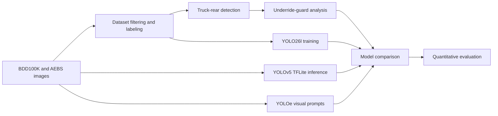
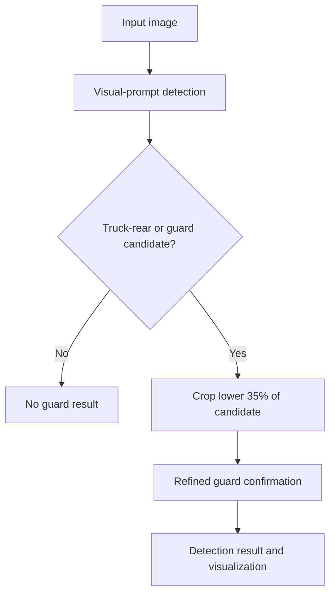

# Truck Rear and Underride Guard Detection

Computer vision research for **Advanced Emergency Braking System (AEBS) validation**. This repository evaluates methods for detecting truck rears and identifying underride protection guards in camera images.

> **Research prototype:** The repository is intended to make the experimental pipeline, data organization, model comparison, and evaluation workflow easy to inspect and reproduce.

## Highlights

- Supervised truck-rear detection with a fine-tuned YOLO26l model.
- Vehicle-orientation comparison using a YOLOv5 FP16 TFLite model.
- Zero-shot underride-guard detection with YOLOe and visual prompts.
- Two-stage inference that refines guard detections using truck-rear crops.
- Quantitative comparison using IoU, precision, recall, F1 score, and detection rate.
- Optional MATLAB tooling for image labeling and evaluation plots.

## Research workflow



## Models

| Model | Method | Weights | Purpose |
| --- | --- | --- | --- |
| **YOLO26l** | Supervised, fine-tuned | `models/yolo26l/best.pt` | Detect truck rears in BDD100K-derived images |
| **YOLOv5** | Supervised, FP16 TFLite | `models/yolov5/best-fp16.tflite` | Compare vehicle-orientation detection performance |
| **YOLOe** | Zero-shot segmentation with visual prompts | `models/yoloe/yoloe-26l-seg.pt` | Detect and refine underride-guard candidates |

### YOLOe two-stage detection



## Dataset organization

The repository contains a filtered BDD100K-derived dataset, a small labeled validation set, AEBS soft-target imagery, and real-truck images.

| Data | Description |
| --- | --- |
| `datasets/rear_trucks/` | Filtered BDD100K dataset: 4,595 training images and 646 validation images |
| `data/raw/bdd100k_samples/` | 25 selected BDD100K frames |
| `data/raw/aebs_target/` | AEBS soft-target imagery |
| `data/raw/real_trucks/` | Real truck photographs |
| `data/prompts/` | Visual-prompt reference images for YOLOe |
| `data/labeled/` | Labeled images and YOLO-format annotations for evaluation |

The filtered BDD100K selection uses rear-view trucks with an aspect ratio of at most 1.0 and a minimum truck height of 80 pixels.

### Annotation format

Labels use the YOLO format:

```text
<class_id> <center_x> <center_y> <width> <height>
```

- `0`: `truck_rear`
- `1`: `underride_guard`

Coordinates are normalized to the image dimensions.

## Installation

The primary target platform is an NVIDIA Jetson Orin running JetPack 6 and CUDA 12.6. Commands below assume the repository root.

```bash
python3 -m venv venv
source venv/bin/activate

pip install typeguard pyyaml
python3 -m pip install torch==2.8.0 torchvision==0.23.0 \
  --index-url=https://pypi.jetson-ai-lab.io/jp6/cu126

pip install 'numpy<2'
pip install ultralytics opencv-python pillow tqdm

python scripts/hardwaretest.py
```

Environment used during development:

- Python 3.10.12
- PyTorch 2.8.0 with CUDA
- Ultralytics 8.4.6
- OpenCV 4.13.0

> The Jetson-specific PyTorch installation command may need to be adapted for a different JetPack, CUDA, or operating-system version.

## Running inference

### YOLO26l

```bash
source venv/bin/activate

yolo detect predict \
  model=models/yolo26l/best.pt \
  source=datasets/rear_trucks/images/val/ \
  imgsz=640 \
  conf=0.5 \
  save=True
```

Or run the repository helper script:

```bash
bash scripts/test_predictions.sh
```

### YOLOv5 TFLite

```bash
source venv/bin/activate
cd yolov5

python detect.py \
  --weights ../models/yolov5/best-fp16.tflite \
  --source ../datasets/rear_trucks/images/val \
  --img 640 \
  --conf 0.25 \
  --project ../runs/detect \
  --name yolov5_eval \
  --save-txt
```

TensorFlow may be required by the local YOLOv5/TFLite setup:

```bash
pip install tensorflow
```

### YOLOe underride-guard detection

```bash
source venv/bin/activate

python scripts/underride_detection.py \
  --source data/labeled/images/ \
  --conf 0.25
```

The script uses visual prompts from `data/prompts/`, detects candidates in the full image, and evaluates the lower portion of each candidate for refined guard confirmation.

## Labeling images

The OpenCV labeling tool writes YOLO-format annotations to `data/labeled/labels/` and annotated images to `data/labeled/images/`.

```bash
source venv/bin/activate
python scripts/label_images.py --source data/raw/bdd100k_samples/
```

| Key | Action |
| --- | --- |
| `1` | Select `truck_rear` |
| `2` | Select `underride_guard` |
| Mouse drag | Draw a bounding box |
| `s` | Save annotation |
| `n` | Move to the next image |
| `u` | Undo the last box |
| `q` | Quit |

## Model comparison

Run all configured models and generate per-model results:

```bash
source venv/bin/activate
python scripts/run_comparison.py --conf 0.25 --iou-threshold 0.5
```

Expected outputs include:

- `results/yolo26l/detections.json`
- `results/yolov5/detections.json`
- `results/yoloe/detections.json`
- `results/summary.csv`

The comparison CSV contains image-level and detection-level information, including model, class, IoU, confidence, and detection status.

## Quantitative evaluation

MATLAB scripts are provided for optional label refinement and evaluation plots.

```matlab
cd matlab
setup_image_labeler
% Refine labels in MATLAB Image Labeler and export a workspace variable named gTruth.
export_labels
quantitative_eval
```

Plots are written to `results/`:

- `mean_iou_comparison.png`
- `precision_recall_chart.png`
- `detection_rate_chart.png`
- `f1_comparison.png`

The evaluation compares mean IoU, precision, recall, F1 score, and detection rate across the available models and classes.

## Training result: YOLO26l

The current YOLO26l training run used 300 epochs on the filtered rear-truck dataset.

| Metric | Value |
| --- | ---: |
| Precision | 0.973 |
| Recall | 0.940 |
| mAP@50 | 0.982 |
| mAP@50-95 | 0.897 |
| Parameters | 24.7M |
| GFLOPs | 86.1 |

These metrics describe the current experiment and should not be interpreted as a general benchmark. Reproducibility depends on the exact dataset split, software versions, hardware, and training configuration.

## Repository structure

```text
.
├── data/                 # Raw images, visual prompts, and labeled evaluation data
├── datasets/             # Filtered BDD100K-derived dataset
├── models/               # Model weights
├── scripts/              # Filtering, labeling, inference, training, and evaluation helpers
├── matlab/               # Optional MATLAB labeling and evaluation tools
├── results/              # Comparison outputs and plots
├── runs/                 # Training and inference artifacts
├── yolov5/               # YOLOv5 inference repository
└── README.md
```

## Limitations and research scope

- BDD100K is a dashcam dataset; underride guards may be too small or occluded for reliable detection at long range.
- The labeled guard set is currently small and is intended for research evaluation rather than production validation.
- YOLOe performance depends on the visual-prompt images and the appearance of the target guard.
- AEBS soft-target and real-truck images provide useful domain coverage but do not replace a large, representative test set.
- Results from different models are not directly equivalent unless preprocessing, confidence thresholds, classes, and evaluation data are held constant.

## Related context

Background on underride protection and guard testing is available in this article from *Forbes*:

- [New Tests Evaluate How Well Side Guards on Semis Do at Preventing Side-Underride Crashes](https://www.forbes.com/sites/jensen/2017/05/10/new-tests-evaluate-how-well-side-guards-on-semis-do-at-preventing-side-underride-crashes/)

## Status

This project is an active research prototype. The repository is suitable for inspecting the current experimental pipeline, reproducing inference runs, extending the labeled dataset, and comparing alternative detection approaches.
